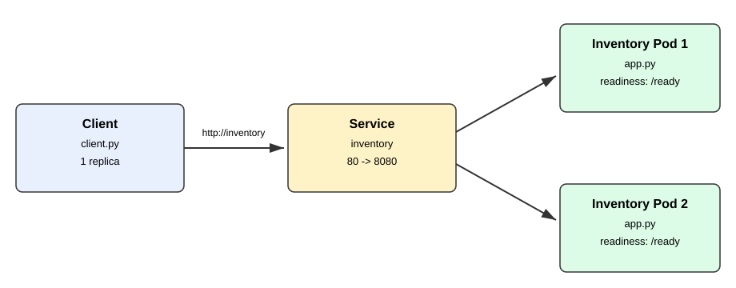
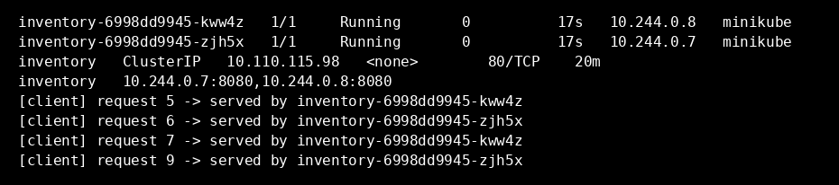
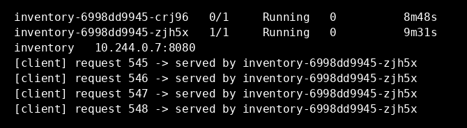
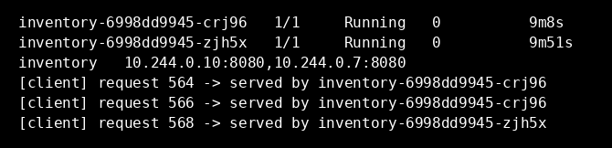
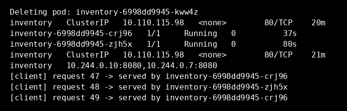

# Inventory Service on Kubernetes

Inventory Service with 2 replicas, exposed by a Service, with 1 client
that requests it by Service name.

## Architecture



The client requests `http://inventory`. The Service named `inventory`
forwards to the ready Inventory Pods. The client never uses Pod addresses.

## Deploying

Start Docker Desktop, then:

```bash
brew install minikube kubectl
minikube start --driver=docker
DOCKER_BUILDKIT=0 docker build -t inventory:local .
DOCKER_BUILDKIT=0 docker build -t client:local -f Dockerfile.client .
minikube image load inventory:local
minikube image load client:local
kubectl apply -f k8s/
kubectl wait --for=condition=ready pod -l app=inventory --timeout=120s
```

The Inventory app serves `/` and `/ready`. `/ready` returns 500 when
`/tmp/unready` exists in that Pod, so readiness can be failed without
stopping the Pod.

## Evidence: both replicas receiving requests

Commands used:

```bash
kubectl get pods -o wide
kubectl get svc inventory
kubectl get endpoints inventory
kubectl logs deployment/client --tail=40
```

Excerpts from that output. Both Running Inventory Pods are in the
endpoints, and both appear in client logs.

```
inventory-6998dd9945-kww4z   1/1     Running       0          17s   10.244.0.8   minikube
inventory-6998dd9945-zjh5x   1/1     Running       0          17s   10.244.0.7   minikube
inventory   ClusterIP   10.110.115.98   <none>        80/TCP    20m
inventory   10.244.0.7:8080,10.244.0.8:8080
[client] request 5 -> served by inventory-6998dd9945-kww4z
[client] request 6 -> served by inventory-6998dd9945-zjh5x
[client] request 7 -> served by inventory-6998dd9945-kww4z
[client] request 9 -> served by inventory-6998dd9945-zjh5x
```



## Evidence: readiness failure

Commands used (`$POD` was `inventory-6998dd9945-crj96`):

```bash
POD=$(kubectl get pods -l app=inventory --field-selector=status.phase=Running -o jsonpath='{.items[0].metadata.name}')
kubectl get pods -l app=inventory
kubectl exec "$POD" -- touch /tmp/unready
# wait 20s for the readiness probe to fail
kubectl get pods -l app=inventory
kubectl get endpoints inventory
kubectl logs deployment/client --tail=15
```

The Pod stayed Running but went to 0/1, the endpoints listed only
the other Pod, and subsequent client requests went only to that Pod.

```
inventory-6998dd9945-crj96   0/1     Running   0          8m48s
inventory-6998dd9945-zjh5x   1/1     Running   0          9m31s
inventory   10.244.0.7:8080
[client] request 545 -> served by inventory-6998dd9945-zjh5x
[client] request 546 -> served by inventory-6998dd9945-zjh5x
[client] request 547 -> served by inventory-6998dd9945-zjh5x
[client] request 548 -> served by inventory-6998dd9945-zjh5x
```



## Evidence: readiness recovery

Commands used (same `$POD` as above):

```bash
kubectl exec "$POD" -- rm /tmp/unready
# wait 20s for the readiness probe to pass again
kubectl get pods -l app=inventory
kubectl get endpoints inventory
kubectl logs deployment/client --tail=15
```

The Pod returned to 1/1, both Pods were in the endpoints again, and
the restored Pod served again.

```
inventory-6998dd9945-crj96   1/1     Running   0          9m8s
inventory-6998dd9945-zjh5x   1/1     Running   0          9m51s
inventory   10.244.0.10:8080,10.244.0.7:8080
[client] request 564 -> served by inventory-6998dd9945-crj96
[client] request 566 -> served by inventory-6998dd9945-crj96
[client] request 568 -> served by inventory-6998dd9945-zjh5x
```



## Evidence: Pod deletion and replacement

Commands used (`$OLD` was `inventory-6998dd9945-kww4z`):

```bash
OLD=$(kubectl get pods -l app=inventory -o jsonpath='{.items[0].metadata.name}')
kubectl get svc inventory
kubectl delete pod "$OLD"
kubectl wait --for=condition=ready pod -l app=inventory --timeout=120s
kubectl get pods
kubectl get svc inventory
kubectl get endpoints inventory
kubectl logs deployment/client --tail=30
```

Kubernetes created `inventory-6998dd9945-crj96` with a different
name. The Service name and ClusterIP were unchanged, and the client
kept succeeding through the Service, with the new Pod serving.

```
Deleting pod: inventory-6998dd9945-kww4z
inventory   ClusterIP   10.110.115.98   <none>        80/TCP    20m
inventory-6998dd9945-crj96   1/1     Running   0          37s
inventory-6998dd9945-zjh5x   1/1     Running   0          80s
inventory   ClusterIP   10.110.115.98   <none>        80/TCP    21m
inventory   10.244.0.10:8080,10.244.0.7:8080
[client] request 47 -> served by inventory-6998dd9945-crj96
[client] request 48 -> served by inventory-6998dd9945-zjh5x
[client] request 49 -> served by inventory-6998dd9945-crj96
```



## Why is a stable Service name useful when Pods can fail or be replaced?

A stable Service name is useful because Pods are not stable. They can
fail readiness, be deleted, or be replaced with new names and new IP
addresses, as shown above. The client does not need to track those
changes, because it always requests the same Service name and
Kubernetes forwards to whichever Pods are currently ready. That keeps
the client working through a Pod failure without any change to the
client itself, and it lets the system scale or replace Pods without
updating callers.

